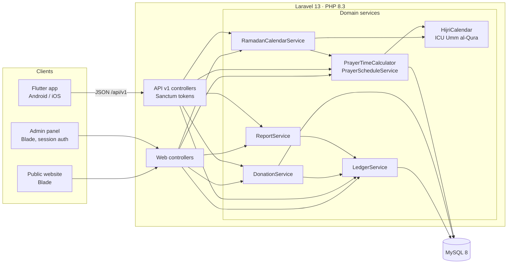
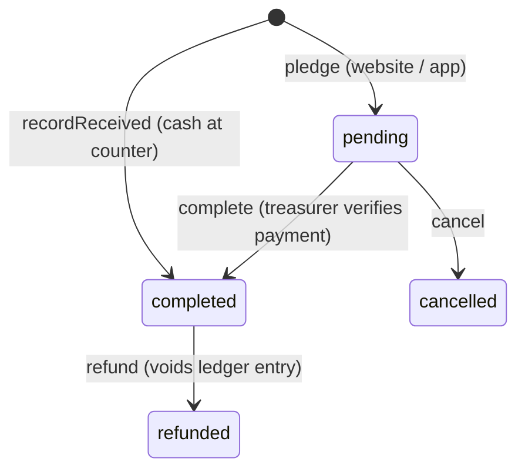
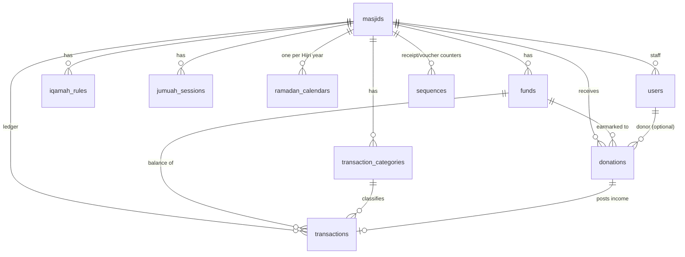

# Masjid App — Architecture

## 1. Overview

One Laravel 13 backend serves three clients from the same domain services:



Controllers are thin: they validate (Form Requests), authorize (gates and middleware) and delegate. Every business rule lives in a service, so the website, the admin panel and the mobile app behave identically.

| Concern | Choice | Why |
| --- | --- | --- |
| Web UI | Server-rendered Blade, one plain CSS file | No JS build step; fast on low-end phones; printable timetables and receipts |
| Mobile | Flutter, consuming `/api/v1` | One codebase for Android and iOS |
| API auth | Laravel Sanctum personal access tokens | One token per device, revocable |
| Web auth | Session login at `/admin/login` | Staff only; the public site needs no login |
| Money | `DECIMAL(14,2)` columns plus `bcmath` | No float rounding in totals |
| Prayer times | Calculated on the fly, not stored | Changing a setting such as the Asr method takes effect immediately; a month takes milliseconds |

## 2. Domain modules

### 2.1 Prayer times

`App\Services\PrayerTimes\PrayerTimeCalculator` is a PHP port of the PrayTimes.org astronomical algorithm (v2.3):

- **Methods:** MWL, ISNA, Egypt, Umm al-Qura (Makkah), Karachi, Tehran, Jafari, Gulf, Kuwait, Qatar, Singapore, Diyanet (Turkey), UOIF (France). They are defined in `App\Enums\CalculationMethod`.
- **Asr:** Standard (shadow factor 1) or Hanafi (factor 2).
- **High latitudes:** angle-based, middle of the night, or one-seventh. These apply when twilight never ends, for example in summer in the UK or Scandinavia.
- **Time zones:** times are solved in UTC and converted with the PHP tz database, so daylight-saving changes are correct automatically.
- **Accuracy:** checked against api.aladhan.com. Hyderabad (Karachi, Hanafi) matches to the minute; London (MWL) is within one minute. These checks are part of the unit tests.

`PrayerScheduleService` adds the masjid layer on top:

- **Iqamah rules** (`iqamah_rules`): either a fixed time or N minutes after adhan, optionally rounded up to 5, 10 or 15 minutes. Each rule has a date range, and the newest rule in effect for a date wins, so seasonal timetables keep their history.
- **Jumuah sessions** (`jumuah_sessions`): one or more khutbahs, each with its own language. They are shown on Fridays.
- Today's Hijri date and the next upcoming prayer.

### 2.2 Hijri and Ramadan calendar

- `HijriCalendar` uses ICU's `islamic-umalqura` calendar through `ext-intl`. Each masjid has a `hijri_adjustment` of −2 to +2 days to follow local moon sighting.
- `RamadanCalendarService` builds the sehri/iftar table:
  - If a masjid has no `ramadan_calendars` row for the year, it **estimates** the start (1 Ramadan per Umm al-Qura plus the adjustment) and the length (29 or 30 days).
  - After the moon is sighted, the admin saves the actual start and length and marks the calendar **confirmed**. They can also add the taraweeh time and community notes.
  - Each day lists sehri end (= Fajr), imsak (Fajr − N minutes, set per masjid), iftar (= Maghrib) and all prayer times. Odd nights of the last ten are flagged (night N begins after iftar on day N−1), and the expected Eid al-Fitr date is included.

### 2.3 Donations

Lifecycle (`DonationService`):



- **Completing a donation** assigns a gap-free receipt number (`RCP-2026-000042`) and posts an income entry to the ledger under the system category **Donations**, linked to the donation polymorphically (`source_type = donation`). Both happen in one database transaction, and the donation row is locked, so a double click cannot post income twice.
- **Funds** separate money by purpose: General, Zakat, Sadaqah, Zakat al-Fitr, Ramadan Iftar, Construction, plus any custom funds. **Restricted** funds (Zakat, Fitrah) cannot be spent beyond their balance.
- Guests may pledge but must leave a name (unless anonymous) and a phone number or email. Signed-in app users see their own history.
- **Payment gateways:** pledges are deliberately gateway-agnostic. To accept card or UPI payments online, add a gateway webhook that calls `DonationService::complete()`; nothing else needs to change.

### 2.4 Ledger (all masjid transactions)

`LedgerService` is the only code that writes to `transactions`:

- **Immutable:** posted entries are never edited or deleted. Corrections are made by **voiding**, which records who voided the entry, when and why, and then re-entering it.
- **Validated:** the category must belong to the masjid and match the entry type (income or expense), and the fund must belong to the masjid.
- **Restricted-fund guard:** expenses from a restricted fund lock the fund row and check the balance. Voiding income that would overdraw a restricted fund is refused.
- **Donation entries** can only be reversed by refunding the donation, which keeps the donations table and the ledger consistent.
- **Numbering:** references are sequential per masjid and per year (`TXN-2026-000001`). They come from the `sequences` table under a row lock.
- **Attachments:** bills and invoices (PDF or image) are stored on the private disk and served only to finance staff.

`ReportService` produces, for any date range: total income, expense and net; totals by category; a monthly breakdown; the number and total of donations; and every fund's balance as of the end date. The admin panel can export the ledger as CSV for the accountant or annual general meeting.

## 3. Data model



Key columns:

- **masjids:** `slug`, `latitude`, `longitude`, `elevation`, `timezone`, `calculation_method`, `asr_method`, `high_latitude_rule`, `hijri_adjustment`, `imsak_minutes_before_fajr`, `currency`, `bank_details`
- **users:** `masjid_id` (nullable), `role` (`admin`, `treasurer` or `member`)
- **donations:** `fund_id`, `user_id?`, `receipt_no`, donor contact, `is_anonymous`, `amount`, `currency`, `payment_method`, `payment_reference`, `status`, `donated_at`, `transaction_id`
- **transactions:** `reference_no`, `type`, `category_id`, `fund_id?`, `amount`, `payment_method`, `party_name`, `description`, `transacted_on`, `status`, `source_type`/`source_id`, `attachment_path`, `recorded_by`, `voided_by`/`voided_at`/`void_reason`

Every record belongs to a `masjid_id`, so one installation can host many masjids. For example, a city council of masjids or a SaaS deployment.

## 4. Security and roles

| Role | Website | Admin panel | API |
| --- | --- | --- | --- |
| Guest | View times and calendars; pledge | — | Public endpoints; pledge |
| Member | Same | — | + own donation history |
| Treasurer | Same | Donations, ledger, reports, funds | + `/admin/*` finance endpoints of **their** masjid |
| Admin | Same | + settings, iqamah, Jumuah, Ramadan, staff | + masjid settings, iqamah rules, Ramadan confirmation |

- Gates `manage-masjid` and `manage-finance` always check that the user belongs to *this* masjid. API child routes use scoped bindings, so another masjid's donation ID returns 404. Web admin routes run `ensureOwned()`.
- Rate limits: 10 requests per minute for login and registration; 20 per minute for pledges.
- Admins cannot remove their own admin role, so a masjid cannot be locked out by accident.
- Mass assignment is protected: `role` and `masjid_id` are never fillable from a request.

## 5. API (v1)

Base URL: `/api/v1`. Errors return JSON: 422 with `errors` for validation, 401, 403, 404.

| Method | Path | Auth | Purpose |
| --- | --- | --- | --- |
| POST | `/auth/register`, `/auth/login` | — | Returns a Sanctum token (`device_name` is required) |
| GET | `/auth/me` · POST `/auth/logout` | token | Current user / revoke token |
| GET | `/masjids?q=` or `?lat=&lng=&radius_km=` | — | Search, or find masjids near a location sorted by distance |
| GET | `/masjids/{slug}` | — | Masjid details and Jumuah sessions |
| GET | `/masjids/{slug}/prayer-times?date=` | — | One day: times, iqamah, Hijri date, next prayer |
| GET | `/masjids/{slug}/prayer-times/monthly?year=&month=` | — | A month timetable |
| GET | `/masjids/{slug}/ramadan/{hijriYear?}` | — | Ramadan calendar (defaults to the current or next Ramadan) |
| GET | `/masjids/{slug}/funds` | — | Active funds |
| POST | `/masjids/{slug}/donations` | optional | Pledge a donation (pending) |
| GET | `/me/donations` | token | My donations |
| PUT | `/masjids/{slug}` | admin | Update settings |
| GET/POST/DELETE | `/masjids/{slug}/iqamah-rules` | admin | Manage iqamah rules |
| PUT | `/masjids/{slug}/ramadan/{hijriYear}` | admin | Confirm the start of Ramadan |
| GET/POST | `/masjids/{slug}/admin/donations` | finance | List, or record a received donation |
| POST | `…/admin/donations/{id}/complete` · `/cancel` · `/refund` | finance | Lifecycle actions |
| GET/POST | `/masjids/{slug}/admin/transactions` | finance | Ledger list, or post an entry (multipart for attachment) |
| POST | `…/admin/transactions/{id}/void` | finance | Void with a reason |
| GET/POST/PUT | `…/admin/funds`, `…/admin/categories` | finance | Manage funds and categories |
| GET | `…/admin/reports/summary?from=&to=` | finance | Financial summary |

The public prayer-time responses send `Cache-Control: public` headers (5 minutes for a day, 1 hour for a month), so a CDN or reverse proxy can absorb Ramadan traffic peaks.

## 6. Code layout

```
backend/
  app/
    Actions/ProvisionMasjid.php        new masjid + default funds, categories, iqamah, admin
    Console/Commands/CreateMasjid.php  php artisan masjid:create
    Enums/                             Role, Prayer, CalculationMethod, AsrMethod, FundType, …
    Http/Controllers/Api/V1/           JSON API (Admin/ = finance endpoints)
    Http/Controllers/Web/              public site, login, Admin/ panel
    Http/Middleware/EnsureMasjidStaff  web admin scoping
    Http/Requests/                     validation shared by web and API
    Http/Resources/                    API JSON shapes
    Models/
    Services/
      PrayerTimes/  Hijri/  Ramadan/  Finance/
  database/migrations/  seeders/  factories/
  resources/views/  public/css/app.css
  tests/Unit  tests/Feature
mobile/            Flutter app (lib/)
docs/ARCHITECTURE.md
```

## 7. Deployment

- **Server:** PHP 8.3 with `intl`, `bcmath`, `pdo_mysql`, `mbstring` and `fileinfo`; MySQL 8 (`utf8mb4`); Nginx or Apache pointing at `backend/public`.
- **Deploy steps:** `composer install --no-dev -o`; set `.env` (`APP_ENV=production`, `APP_DEBUG=false`, DB credentials, `APP_URL`); then run `php artisan migrate --force`, `config:cache`, `route:cache` and `view:cache`.
- **First masjid:** `php artisan masjid:create`.
- **Queue and scheduler:** not required today. Add them when you introduce emailed receipts or push notifications.
- **Backups:** daily `mysqldump` of the database plus `storage/app/private` (ledger attachments). The ledger is the financial record, so treat these backups as essential.

## 8. Roadmap

1. Online payment gateway (Razorpay, Stripe or PayPal) webhook that calls `DonationService::complete()`.
2. Emailed and WhatsApp receipts, sent through a queued notification when a donation completes.
3. Push notifications in the app for adhan reminders and announcements (Firebase Cloud Messaging).
4. Announcements and events (classes, janazah notices).
5. Recurring monthly pledges, and Zakat calculator helpers.
6. Approval workflow for large expenses (two-person rule).
